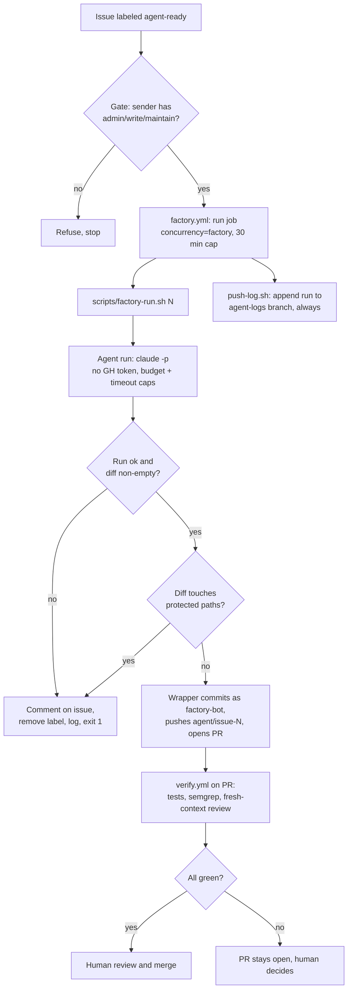
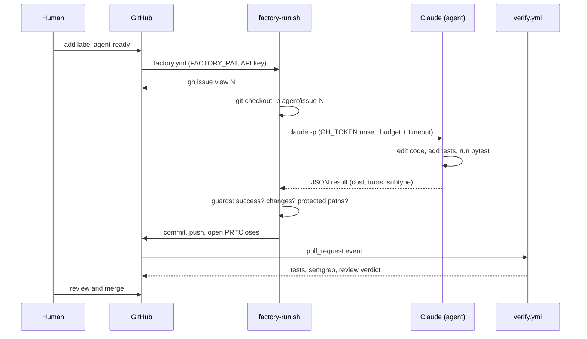
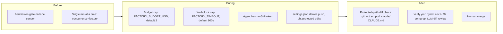

# factory-sandbox

Throwaway repo for testing the **issue-to-PR factory**: label a GitHub issue `agent-ready`, a headless Claude run implements it, a bot opens a PR, an independent CI judge checks it, a human merges.

The app itself is trivial (`app.py`: `add(a, b)`). The factory is the point.

## Flow



## Components

| File | Role |
|------|------|
| `.github/workflows/factory.yml` | Trigger on `labeled`. `gate` job checks sender permission; `run` job calls the wrapper, then pushes the log. |
| `scripts/factory-run.sh` | Wrapper. Branch, run the agent under caps, check diff, commit, push, open PR, write log line. Never retries. |
| `scripts/push-log.sh` | Appends `factory-runs.jsonl` to the `agent-logs` branch. |
| `scripts/test-factory-run.sh` | Wrapper test with a fake `claude` (dry mode): lock cleanup, log line shape, timeout, protected paths. |
| `.github/workflows/verify.yml` | Independent judge on every PR to `main`. |
| `CLAUDE.md` | Rules the agent follows. |
| `.claude/settings.json` | Denies `git push`, `gh`, and edits to `.github/`, `scripts/`, `.claude/`. |

## Who holds which power

The agent can edit code and run tests. It cannot touch git remotes or GitHub. The wrapper does that.



## Guardrails



Why the protected-path check matters: the agent must not weaken its own judge (CI, wrapper, config).

## Run statuses

Every run appends one JSON line to `factory-runs.jsonl`:

```json
{"issue":7,"duration_s":42,"turns":5,"cost_usd":0.31,"status":"ok","pr":"https://github.com/.../pull/8"}
```

| `status` | Meaning |
|----------|---------|
| `ok` | PR opened |
| `issue-fetch-failed` | `gh issue view` failed |
| `branch-exists` | `agent/issue-N` already exists |
| `timeout` | Hit `FACTORY_TIMEOUT` |
| `failed:rc=…,subtype=…` | Agent errored or hit budget |
| `no-changes` | Agent produced no diff |
| `touched-protected-paths` | Diff edits `.github/`, `scripts/`, `.claude/` or `CLAUDE.md` |
| `commit-failed` / `push-failed` / `pr-failed` | Git or `gh` step failed |

Any non-`ok` status: wrapper comments on the issue, removes `agent-ready`, exits 1. No retry. Fix the issue and re-add the label to rerun.

## Config

| Env var | Default | Where set |
|---------|---------|-----------|
| `FACTORY_BUDGET_USD` | `2` | `factory.yml` |
| `FACTORY_TIMEOUT` | `900` | `factory.yml` |
| `FACTORY_LOG` | `factory-runs.jsonl` | wrapper |
| `CLAUDE_BIN` | `claude` | wrapper (tests override) |
| `FACTORY_DRY` | unset | tests: skip `gh` and push |

Secrets: `FACTORY_PAT` (bot PAT: push, PR, comment), `ANTHROPIC_API_KEY`.

## Local dev

```bash
pip install -r requirements-dev.txt
python -m pytest -q                 # app tests
bash scripts/test-factory-run.sh    # wrapper tests (needs jq, git)
```
