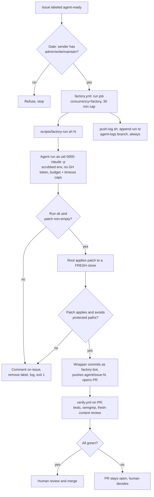
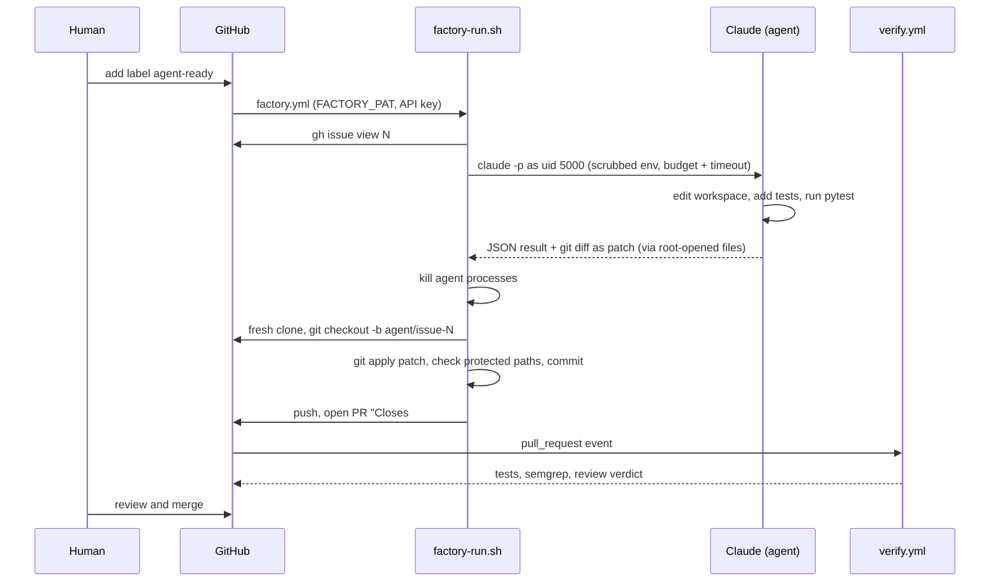
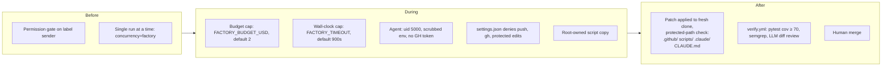

# factory-sandbox

Run the wrapper tests with scripts/test-factory-run.sh

Run the app tests with: python3 -m pytest -q

Throwaway repo for testing the **issue-to-PR factory**: label a GitHub issue `agent-ready`, a headless Claude run implements it, a bot opens a PR, an independent CI judge checks it, a human merges.

The app itself is trivial (`app.py`: `add(a, b)`). The factory is the point.

## Flow



## Components

| File | Role |
|------|------|
| `.github/workflows/factory.yml` | Trigger on `labeled`. `gate` job checks sender permission; `run` job calls the wrapper, then pushes the log. |
| `scripts/factory-run.sh` | Wrapper, runs as root and is the only holder of the PAT. Runs the agent, takes its patch, applies it to a fresh clone, commits, pushes, opens PR, writes log line. Never retries. |
| `scripts/push-log.sh` | Appends `factory-runs.jsonl` to the `agent-logs` branch. |
| `scripts/test-factory-run.sh` | Wrapper test with a fake `claude` (dry mode): lock cleanup, log line shape, timeout, protected paths. |
| `scripts/install.sh` | Installs the factory into another GitHub repo via PR (see [Install in another repo](#install-in-another-repo)). |
| `scripts/test-install.sh` | Installer test against a local bare repo with `gh` calls echoed: files land, test cmd substituted, re-run is a no-op. |
| `.github/workflows/verify.yml` | Independent judge on every PR to `main`. |
| `CLAUDE.md` | Rules the agent follows. |
| `.claude/settings.json` | Denies `git push`, `gh`, and edits to `.github/`, `scripts/`, `.claude/`. |

## Who holds which power

The agent can edit code and run tests. It cannot touch git remotes or GitHub. The wrapper does that.

The CI step runs as root and holds `FACTORY_PAT`. The agent runs as a separate `agent` user:

- **uid 5000, not the default 1001.** 1001 is the host runner user, which owns the runner's step control files (e.g. `GITHUB_ENV`). A colliding uid would let the agent plant env changes for later root steps. The step fails unless `agent` is uid 5000.
- **Scrubbed env.** `env -i` with only `HOME`, `PATH` and `ANTHROPIC_API_KEY`. No GitHub token.
- **Root-owned scripts.** `scripts/` is copied to `/opt/factory` (not group/world-writable) and run from there, so the agent cannot rewrite the wrapper. The log goes to `/opt/factory-out`.
- **Patch is data.** Root never runs git inside the agent-writable workspace (a poisoned `.git/config` or hook would run with the token). The agent produces a patch; root applies it to a fresh clone with `core.hooksPath=/dev/null`.
- **No symlink tricks.** Root's temp dir is root-only. Output files are opened by root and the agent writes through inherited fds.
- **Kill before read.** Leftover agent processes are killed before root reads anything.



## Guardrails



Why the protected-path check matters: the agent must not weaken its own judge (CI, wrapper, config).

## Run statuses

Every run appends one JSON line to `factory-runs.jsonl`:

```json
{"issue":7,"duration_s":42,"turns":5,"cost_usd":0.31,"status":"ok","pr":"https://github.com/.../pull/8"}
```

| `status` | Meaning |
|----------|---------|
| `ok` | PR opened |
| `issue-fetch-failed` | `gh issue view` failed |
| `timeout` | Hit `FACTORY_TIMEOUT` |
| `failed:rc=…,subtype=…` | Agent errored or hit budget |
| `patch-step-failed` | Agent-side `git add`/`diff` failed |
| `no-changes` | Agent produced no diff |
| `clone-failed` / `branch-failed` | Fresh clone or branch creation failed |
| `patch-failed` | Patch did not apply to the fresh clone |
| `touched-protected-paths` | Diff edits `.github/`, `scripts/`, `.claude/` or `CLAUDE.md` |
| `commit-failed` / `push-failed` / `pr-failed` | Git or `gh` step failed |

Any non-`ok` status: wrapper comments on the issue, removes `agent-ready`, exits 1. No retry. Fix the issue and re-add the label to rerun.

## Config

| Env var | Default | Where set |
|---------|---------|-----------|
| `FACTORY_BUDGET_USD` | `2` | repo variable of the same name, else `2` (`factory.yml`) |
| `FACTORY_TIMEOUT` | `900` | repo variable of the same name, else `900` (`factory.yml`) |
| `FACTORY_AGENT_USER` | `agent` in CI, empty in tests | `factory.yml` (empty = run agent as same user) |
| `FACTORY_LOG` | `factory-runs.jsonl` | wrapper; CI sets `/opt/factory-out/factory-runs.jsonl` |
| `CLAUDE_BIN` | `claude` | wrapper (tests override) |
| `FACTORY_DRY` | unset | tests: skip `gh` and push; clone from `FACTORY_CLONE_URL` |

Secrets: `FACTORY_PAT` (bot PAT: push, PR, comment), `ANTHROPIC_API_KEY`.

## Install in another repo

```bash
scripts/install.sh OWNER/REPO [--test "npm test"] [-y]
```

Needs `gh` with admin on the target. Files are copied from the checkout you run it from, so use a commit you trust. It:

1. Clones the target, branches `chore/add-factory`, copies `factory.yml`, `verify.yml`, `factory-run.sh`, `push-log.sh`.
2. Swaps in the default branch name and `--test` command, appends the agent rules to `CLAUDE.md` once.
3. Pushes and opens a PR. Review it before merging.
4. Creates the `agent-ready` label, prompts for missing `ANTHROPIC_API_KEY` and `FACTORY_PAT`.
5. Sets branch protection (PR plus `tests`, `semgrep`, `review`). Warns instead of failing if the plan or permissions refuse.

Re-running continues the open branch and is a no-op when nothing changed.

Limits:
- `verify.yml` is Python-specific (setup-python, pip, semgrep `p/python`). `--test` swaps only the test command. Edit the other steps by hand for other stacks.
- The real `gh` calls (clone, secrets, protection) are untested. Try it on a throwaway repo first.
- Use a low-limit `ANTHROPIC_API_KEY` and a fine-grained `FACTORY_PAT` scoped to the one repo.

## Local dev

```bash
pip install -r requirements-dev.txt
python -m pytest -q                 # app tests
bash scripts/test-factory-run.sh    # wrapper tests (needs jq, git)
bash scripts/test-install.sh        # installer tests (needs git)
```
